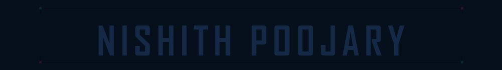

<!-- ═══════════════════════════════════════════════════════════════════
     NISHITH POOJARY — Anime Cyberpunk GitHub Profile
     ═══════════════════════════════════════════════════════════════════ -->

<!-- ╔═══════════════════════════════════════════════════════════════╗
     ║  SECTION 1 — PROFILE HEADER                                  ║
     ╚═══════════════════════════════════════════════════════════════╝ -->

<div align="center">


<br/>

<!-- Primary: animated GIF with genuine ON/OFF neon effect (60 frames, 6s loop) -->
<!-- Fallback SVG with SMIL animation available at: assets/animated-name.svg -->


<br/>

<samp>Computer Science Engineer · Developer · Tech Explorer</samp>

<br/><br/>

<a href="https://github.com/Nishith-R-hub"></a>&nbsp;
<a href="https://www.linkedin.com/in/nishith-poojary-51278028b"></a>&nbsp;
<a href="mailto:rnishith45@gmail.com"></a>

</div>

<!-- ╔═══════════════════════════════════════════════════════════════╗
     ║  SECTION 2 — ABOUT ME                                       ║
     ╚═══════════════════════════════════════════════════════════════╝ -->


<div>

I'm a final-year **B.E. Computer Science and Engineering** student at **Shri Madhwa Vadiraja Institute of Technology and Management (SMVITM)**, Bantakal, Karnataka, India — graduating in **2027**.

I enjoy building practical software solutions — from web applications and cloud-deployed tools to machine-learning workflows that address real-world problems. My interests span **full-stack web development**, **artificial intelligence & machine learning**, **IoT**, and **technology-driven problem solving**.

> 🌊 **Current research:** Collaborating in a four-member final-year project combining Sentinel-1 SAR satellite imagery, AIS vessel-tracking data, machine learning, and oceanographic information to investigate suspected illegal marine bilge dumping.

</div>

<!-- ╔═══════════════════════════════════════════════════════════════╗
     ║  SECTION 3 — FEATURED PROJECTS                              ║
     ╚═══════════════════════════════════════════════════════════════╝ -->


<table>
<tr>
<td width="50%" valign="top">

### 🛰️ Illegal Bilge-Dumping Detection
**Sentinel-1 SAR + AIS Fusion**

An ongoing four-member final-year research project combining satellite radar imagery, vessel-tracking information, machine learning, and oceanographic data to investigate suspected illegal marine bilge dumping.

`Python` `Sentinel-1 SAR` `AIS` `Isolation Forest` `Random Forest` `ERA5` `CMEMS`

<sub>🌊 Ongoing research</sub>

</td>
<td width="50%" valign="top">

### ☁️ Cloud-Deployed Student Grade Calculator

A Flask-based web application for calculating student grades, prepared for cloud deployment.

`Python` `Flask` `Jinja2` `Gunicorn`

<sub>☁️ Course project</sub>

</td>
</tr>
<tr>
<td width="50%" valign="top">

### 🧠 FlashMind — AI-Powered Flashcard & Quiz Generator

An educational application for generating flashcards and quizzes with NLP-assisted functionality.

`Python` `Flask` `SQLite` `Hugging Face NLP`

<sub>🧠 Full-stack web app</sub>

</td>
<td width="50%" valign="top">

### ♻️ EcoTrace — Community Waste Accountability

A sustainability-focused concept for community waste accountability using communication-based reporting.

`Python` `SMS/Call-Based System`

<sub>♻️ Srishti Innovation Exchange</sub>

</td>
</tr>
<tr>
<td width="50%" valign="top">

### 📊 Student Performance & Placement Analytics

A data analytics project focused on student performance and placement insights.

`Python` `SQL` `Power BI`

<sub>📊 Data analytics</sub>

</td>
<td width="50%" valign="top">

### 📝 Student Feedback Website

A website for collecting and managing student feedback.

`HTML` `CSS` `JavaScript` `Backend` `Database`

<sub>📝 Web application</sub>

</td>
</tr>
<tr>
<td colspan="2" valign="top">

### 💧 Wateroo — IoT Water Quality Monitoring Device

An IoT concept for monitoring water quality using connected hardware.

`ESP32` `Embedded C` `IoT`

<sub>💧 Hardware / IoT project</sub>

</td>
</tr>
</table>

<div align="center">
<a href="https://github.com/Nishith-R-hub?tab=repositories"></a>
</div>

<!-- ╔═══════════════════════════════════════════════════════════════╗
     ║  SECTION 4 — TECHNICAL SKILLS                               ║
     ╚═══════════════════════════════════════════════════════════════╝ -->


#### Languages
<p>
&nbsp;
&nbsp;
&nbsp;
&nbsp;
&nbsp;

</p>

#### Frontend
<p>
&nbsp;
&nbsp;
&nbsp;

</p>

#### Backend & Frameworks
<p>
&nbsp;
&nbsp;

</p>

#### Databases
<p>
&nbsp;

</p>

#### AI & Data Science
<p>
&nbsp;
&nbsp;
&nbsp;
&nbsp;

</p>

#### Cloud & Tools
<p>
&nbsp;
&nbsp;
&nbsp;
&nbsp;
&nbsp;

</p>

<div align="center">
<sub><code>DSA</code> · <code>OOP</code> · <code>DBMS</code> · <code>Operating Systems</code> · <code>Computer Networks</code> · <code>SDLC</code></sub>
</div>

<!-- ╔═══════════════════════════════════════════════════════════════╗
     ║  SECTION 5 — EDUCATION                                      ║
     ╚═══════════════════════════════════════════════════════════════╝ -->


### 🎓 Education

**B.E. in Computer Science and Engineering**
Shri Madhwa Vadiraja Institute of Technology and Management (SMVITM)
Bantakal, Karnataka, India · 2023–2027
Expected graduation: **2027**

<!-- ╔═══════════════════════════════════════════════════════════════╗
     ║  SECTION 6 — EXPERIENCE / RESEARCH                         ║
     ╚═══════════════════════════════════════════════════════════════╝ -->


### 🔬 Ongoing Research

**Illegal Bilge-Dumping Detection Using Sentinel-1 SAR and AIS Fusion**

Collaborating in a four-member final-year research project that combines **Sentinel-1 SAR** satellite radar imagery, **AIS** vessel-tracking data, **machine learning** (Isolation Forest, Random Forest), and **oceanographic information** (ERA5, CMEMS) to investigate suspected illegal marine bilge dumping.

<sub>🌊 This research is ongoing and has not been published.</sub>

### 💡 Srishti Innovation Exchange

**EcoTrace** — A sustainability concept for community waste accountability using communication-based reporting.

<!-- ╔═══════════════════════════════════════════════════════════════╗
     ║  SECTION 7 — GITHUB STATISTICS                              ║
     ╚═══════════════════════════════════════════════════════════════╝ -->


<table>
<tr>
<td width="50%" align="center" valign="middle">
<a href="https://github.com/Nishith-R-hub"></a>
</td>
<td width="50%" align="center" valign="middle">
<a href="https://github.com/Nishith-R-hub"></a>
</td>
</tr>
</table>

<!-- ╔═══════════════════════════════════════════════════════════════╗
     ║  SECTION 8 — CONTRIBUTION STREAK                            ║
     ╚═══════════════════════════════════════════════════════════════╝ -->

<div align="center">
<a href="https://github.com/Nishith-R-hub"></a>
</div>

<!-- ╔═══════════════════════════════════════════════════════════════╗
     ║  SECTION 9 — ACTIVITY GRAPH                                 ║
     ╚═══════════════════════════════════════════════════════════════╝ -->

<div align="center">
<a href="https://github.com/Nishith-R-hub"></a>
</div>

<sub align="center"><p align="center">Statistics are generated by external services and may occasionally be unavailable or rate-limited. Values are not manually fabricated.</p></sub>

<!-- ╔═══════════════════════════════════════════════════════════════╗
     ║  SECTION 10 — CONTRIBUTION SNAKE                            ║
     ╚═══════════════════════════════════════════════════════════════╝ -->


<div align="center">


<sub>Every contribution leaves a trail.</sub>

</div>

<!-- ╔═══════════════════════════════════════════════════════════════╗
     ║  SECTION 11 — CONTACT                                       ║
     ╚═══════════════════════════════════════════════════════════════╝ -->


<div align="center">

<a href="https://github.com/Nishith-R-hub"></a>&nbsp;
<a href="https://www.linkedin.com/in/nishith-poojary-51278028b"></a>&nbsp;
<a href="mailto:rnishith45@gmail.com"></a>

</div>

<!-- ╔═══════════════════════════════════════════════════════════════╗
     ║  SECTION 12 — FOOTER                                        ║
     ╚═══════════════════════════════════════════════════════════════╝ -->

<div align="center">

<br/>

```
 ╔═══════════════════════════════════════════════════╗
 ║   💙  BUILD · LEARN · CREATE · IMPROVE           ║
 ╚═══════════════════════════════════════════════════╝
```

<sub>Thanks for visiting · Keep learning, build practical technology, and solve real-world problems.</sub>

<br/>


</div>
